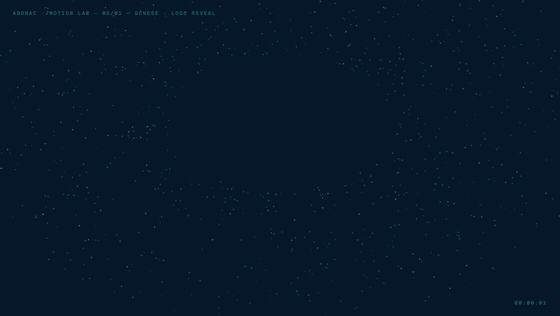
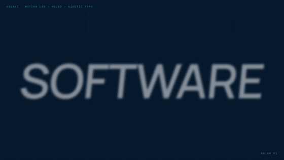
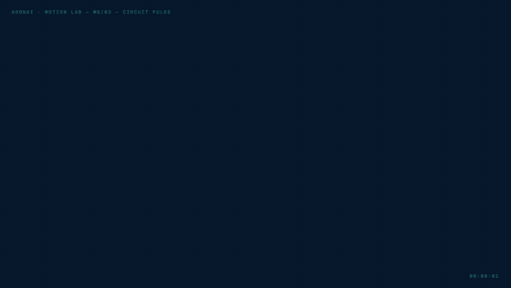
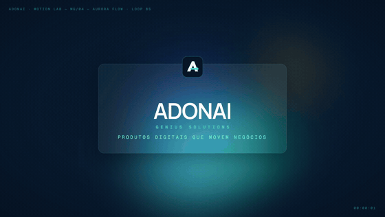
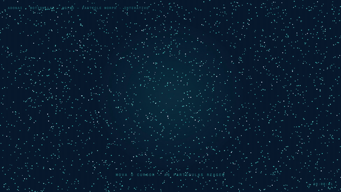
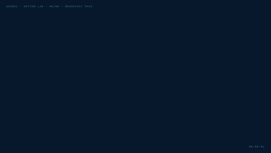

# ADONAI Motion Graphics

**6 peças de motion graphics para a ADONAI Genius Solutions — criadas 100% por código com o modelo [GLM-5.3-Flash](https://z.ai) no [ZCode](https://zcode.ai), sem After Effects, sem plugins, sem assets de terceiros.**

Este repositório é um estudo de capacidade: o que um LLM de fronteira consegue produzir sozinho em uma sessão — da extração da identidade visual da marca no site oficial até vídeo 1080p30 com sound design sincronizado, pronto para publicar.

| | |
|---|---|
|  |  |
| **01 · Gênese** — logo reveal com 1.000 partículas | **02 · Kinetic Type** — typografia cinética das frentes da marca |
|  |  |
| **03 · Circuit Pulse** — trilhas de circuito acendem o logo | **04 · Aurora Flow** — gradientes orgânicos, loop perfeito 8s |
|  |  |
| **05 · Particle Morph** — 2.600 partículas, interativo | **06 · Broadcast Pack** — lower third, badge e stinger |

> Todas as peças têm **som**: trilha e efeitos sintetizados do zero e sincronizados quadro a quadro (veja `sound-engine.js`). Nos vídeos (`exports/*.mp4`) o áudio já está mixado; nas demos HTML, clique em **🔊 ATIVAR SOM**.

## Destaques técnicos

- **Identidade real, não inventada**: o site oficial foi aberto no navegador e analisado — logo oficial replicado em SVG path a path (o "A" sólido com nó turquesa), paleta extraída do CSS (`#31DDD4`, `#07182D`, `#F7F8F4`...), tipografia Manrope 600 + Geist Mono self-hosted.
- **Animação determinística**: cada peça desenha por `render(t)` com PRNG semeado — o mesmo `t` gera sempre o mesmo quadro. Isso permite exportar vídeo via *seek* (Playwright + ffmpeg) idêntico ao playback no navegador.
- **Sound design em código**: um único motor (`sound-engine.js`) renderiza a trilha no navegador (Web Audio) e no arquivo WAV usado no MP4 — browser e vídeo tocam exatamente o mesmo som.
- **Loops perfeitos**: as peças 04 e 05 têm período de 8s com frequências inteiras e caudas que envolvem o início — vídeo, animação e áudio emendam sem costura.
- **Zero ferramentas pagas**: nada de After Effects/Illustrator; apenas código, Chrome e ffmpeg.

## Como rodar

```bash
git clone https://github.com/jesaiasmaia/adonai-motion-graphics.git
cd adonai-motion-graphics
open index.html   # galeria com previews, demos ao vivo e downloads
```

Re-exportar (opcional):

```bash
cd tools && npm i            # playwright-core (usa o Chrome instalado) + ffmpeg no PATH
node export.mjs smoke        # 3 frames de teste por peça
node export.mjs full         # MP4 1080p30 + GIF 560px em exports/
node render-audio.mjs        # sintetiza WAVs e mixa o áudio nos MP4
```

## Estrutura

```
├── index.html            # galeria (previews + links)
├── 0X-*.html             # as 6 peças (HTML autocontido, rodam direto no navegador)
├── motion-core.js        # fontes, easings, PRNG, logo oficial em SVG, relógio de export
├── sound-engine.js       # síntese do som de cada peça (compartilhado browser/Node)
├── audio.js              # player das demos (botão 🔊, tecla M)
├── fonts/                # Manrope + Geist Mono (variáveis, woff2)
├── exports/              # MP4 1080p30 (com som) + GIF 560px + WAV + variantes web
├── docs/integracao-site.md  # estudo: como colocar o Gênese no adonaitech.com.br
└── tools/                # export.mjs (vídeo) e render-audio.mjs (som → MP4)
```

## Integrar no site

O estudo completo — comparativo de formatos, plano passo a passo para o Next.js, componente pronto, checklist de performance — está em **[docs/integracao-site.md](docs/integracao-site.md)**.

## Créditos

- Marca **ADONAI Genius Solutions** © [adonaitech.com.br](https://adonaitech.com.br)
- Código e motion: gerados por GLM-5.3-Flash (ZCode) — código livre para uso da marca
